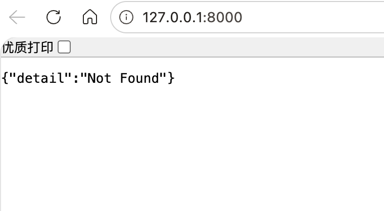

# OneQMultiA 项目开发文档

> 一问多答 —— AI智能问答聚合系统

## 1. 项目概述

### 1.1 项目背景

单独使用某一个AI问答平台时，答案往往不够完美和全面。用户需要手动将同一问题复制到多个平台获取不同答案，操作低效且难以对比分析。

### 1.2 核心目标

用户提出一个问题，系统自动将问题分发到全网多个AI问答平台，聚合所有回答后统一展示、对比和分析。

### 1.3 工作流程

```
用户提问 → 系统并发分发到N个AI平台 → 收集各平台回答 → 聚合展示/对比/分析 → 用户继续提问（循环）
```

---

## 2. 功能需求

### 2.1 核心功能

| 功能模块 | 描述 | 优先级 |
|---------|------|--------|
| 多平台并发问答 | 将用户问题并发发送到22+个AI平台，收集回答 | P0 |
| 答案聚合展示 | 将各平台回答聚合排布在问题下方 | P0 |
| 答案对比分析 | 支持对比各平台答案的差异和优劣 | P1 |
| 问答历史记录 | 完整保存所有问答会话记录 | P0 |
| 精确时间记录 | 记录每个AI的响应时间和回答完成时间 | P0 |
| 文档导出 | 支持导出为PDF/WORD/HTML/MD/TXT | P1 |
| 网络分享 | 支持生成分享链接，分享对话记录 | P2 |
| 移动端支持 | 手机浏览器/PWA访问，响应式UI，完整功能 | P1 |
| 平台动态管理 | 支持在UI中新增、修改、启用/禁用、删除AI平台 | P0 |

### 2.2 预置AI平台（22个，可动态增删改）

> 以下为系统预置的初始平台列表。用户可在运行时通过管理界面自由新增、修改、启用/禁用或删除任意平台。

#### 国际平台（6个）

| 平台 | URL | 备注 |
|------|-----|------|
| ChatGPT | https://chatgpt.com/ | OpenAI |
| Gemini | https://gemini.google.com/app | Google |
| Grok | https://grok.com/ | xAI |
| Copilot | https://copilot.microsoft.com/ | Microsoft |
| Perplexity AI | https://www.perplexity.ai/ | 搜索增强 |
| Pi | https://pi.ai/talk | Inflection |

#### 国内平台（16个）

| 平台 | URL | 备注 |
|------|-----|------|
| DeepSeek | https://chat.deepseek.com/ | 深度求索 |
| DouBao（豆包） | https://www.doubao.com/chat/ | 字节跳动 |
| QianWen（通义千问Web） | https://www.qianwen.com/ | 阿里巴巴 |
| Qwen（通义千问Chat） | https://chat.qwen.ai/ | 阿里巴巴 |
| Kimi | https://www.kimi.com/ | 月之暗面 |
| ChatGLM（智谱清言） | https://chatglm.cn/ | 智谱AI |
| MiniMaxAgent | https://agent.minimaxi.com/ | MiniMax |
| LongCat | https://longcat.chat/ | 长猫 |
| 元宝 | https://yuanbao.tencent.com/ | 腾讯 |
| 灵光 | https://www.lingguang.com/chat | 灵光AI |
| 阶跃AI | https://www.stepfun.com/chats/new | 阶跃星辰 |
| 紫东太初 | https://www.zidongtaichu.com/ | 中科院 |
| 商汤商量 | https://chat.sensetime.com/ | 商汤科技 |
| 天工Agent | https://www.tiangong.cn/ | 昆仑万维 |
| 万联摩尔 | https://www.wanmol.com/ | 万联摩尔 |
| 扣子 | https://www.coze.cn/ | 字节跳动 |

### 2.3 平台动态管理功能

AI技术发展迅猛，新平台不断涌现，旧平台可能关停或改版。系统必须支持**无需改代码**即可灵活管理平台。

#### 2.3.1 管理操作

| 操作 | 说明 |
|------|------|
| **新增平台** | 通过UI表单填写平台名称、URL、页面选择器配置，即可接入新AI平台 |
| **修改平台** | 编辑已有平台的URL、选择器、超时时间等配置（平台改版时快速修复） |
| **启用/禁用** | 临时关闭某平台参与问答，不删除配置，一键恢复 |
| **删除平台** | 彻底移除不再需要的平台（历史回答数据保留） |
| **排序** | 拖拽调整平台显示顺序 |
| **分组** | 按类别分组管理（国际/国内/自定义分组） |
| **连接测试** | 一键测试某平台是否可用（登录态是否有效、页面是否可访问） |
| **批量操作** | 批量启用/禁用/删除多个平台 |

#### 2.3.2 平台配置项

每个平台的完整配置（全部通过UI或配置文件管理，无需写代码）：

```yaml
# 示例：一个平台的完整配置
- platform_id: "chatgpt"
  display_name: "ChatGPT"
  url: "https://chatgpt.com/"
  icon: "chatgpt.svg"              # 平台图标
  group: "international"           # 分组：international / domestic / custom
  enabled: true                    # 是否启用
  sort_order: 1                    # 显示排序
  timeout_seconds: 120             # 超时时间
  selectors:                       # 页面元素选择器（核心）
    input_box: "#prompt-textarea"          # 输入框
    send_button: "button[data-testid='send-button']"  # 发送按钮
    response_container: ".markdown"        # 回答容器
    response_complete_indicator: "..."     # 回答完成标志
    new_chat_button: "..."                 # 新对话按钮
  interaction:                     # 交互方式配置
    input_method: "fill"           # fill / type / paste
    send_method: "click"           # click / enter
    wait_strategy: "mutation"      # mutation / selector / polling
  health_check:
    last_checked: null
    last_status: null
  created_at: "2026-03-29T00:00:00"
  updated_at: "2026-03-29T00:00:00"
```

#### 2.3.3 两层适配架构

为兼顾"零代码快速接入"和"深度定制"，采用两层适配架构：

| 层级 | 适用场景 | 原理 |
|------|---------|------|
| **通用适配器（GenericAdapter）** | 大多数AI平台 | 基于配置文件中的选择器驱动，无需写代码 |
| **专用适配器（SpecializedAdapter）** | 交互逻辑复杂的平台 | 继承基类，用Python代码实现特殊逻辑 |

```
用户新增平台
    │
    ├─ 标准页面结构 → 填写选择器配置 → GenericAdapter自动驱动 → 完成✅
    │                 （无需写代码）
    │
    └─ 复杂交互逻辑 → 先用GenericAdapter尝试
                        │
                        ├─ 能工作 → 完成✅
                        └─ 不能 → 开发SpecializedAdapter（写代码） → 注册到系统
```

---

## 3. 技术架构

### 3.1 整体架构

采用**客户端-服务器分离架构**。Playwright浏览器自动化运行在服务端（桌面/服务器），手机和桌面浏览器作为客户端通过网络访问。

```
┌─ 客户端（多端访问）─────────────────────────────────┐
│                                                     │
│  ┌──────────┐  ┌──────────┐  ┌───────────────────┐  │
│  │ 桌面浏览器  │  │ 手机浏览器  │  │ 手机PWA（安装到桌面）│  │
│  └─────┬────┘  └─────┬────┘  └────────┬──────────┘  │
│        │             │                │              │
│        └─────────────┼────────────────┘              │
│                      │ HTTP / WebSocket              │
└──────────────────────┼──────────────────────────────┘
                       │
┌─ 服务端 ─────────────┼──────────────────────────────┐
│                      ▼                               │
│  ┌─────────────────────────────────────────────────┐ │
│  │            前端展示层 (Frontend)                   │ │
│  │    React + TypeScript + PWA + 响应式设计           │ │
│  │  ┌────────┬────────┬──────────┬──────────────┐   │ │
│  │  │问答交互  │答案对比  │ 历史记录   │ 导出/分享     │   │ │
│  │  │面板     │面板     │ 面板      │ 面板          │   │ │
│  │  └────────┴────────┴──────────┴──────────────┘   │ │
│  └─────────────────────────────────────────────────┘ │
│  ┌─────────────────────────────────────────────────┐ │
│  │            后端服务层 (Backend)                    │ │
│  │                 FastAPI                           │ │
│  │  ┌──────────┬──────────┬────────┬────────────┐   │ │
│  │  │问答调度引擎│平台适配管理│会话管理 │导出与分享服务│   │ │
│  │  └──────────┴──────────┴────────┴────────────┘   │ │
│  └─────────────────────────────────────────────────┘ │
│  ┌─────────────────────────────────────────────────┐ │
│  │         浏览器自动化层 (Browser Automation)        │ │
│  │                  Playwright                       │ │
│  │  ┌───────────────────────────────────────────┐   │ │
│  │  │ 22个AI平台的浏览器控制器（并发执行）          │   │ │
│  │  │ 复用用户已登录的浏览器Session               │   │ │
│  │  └───────────────────────────────────────────┘   │ │
│  └─────────────────────────────────────────────────┘ │
│  ┌─────────────────────────────────────────────────┐ │
│  │              数据存储层 (Storage)                  │ │
│  │  ┌──────────┬──────────────┬────────────────┐    │ │
│  │  │ SQLite/   │ 问答记录持久化  │ 导出文件临时存储 │    │ │
│  │  │ PostgreSQL│              │                │    │ │
│  │  └──────────┴──────────────┴────────────────┘    │ │
│  └─────────────────────────────────────────────────┘ │
└─────────────────────────────────────────────────────┘
```

### 3.2 技术选型

| 层级 | 技术 | 选型理由 |
|------|------|---------|
| 前端（MVP） | Streamlit | 快速原型，Python生态，适合MVP验证 |
| 前端（正式） | React + TypeScript + PWA | 复杂交互、实时流式展示、组件化、移动端安装 |
| 移动端适配 | TailwindCSS 响应式 + PWA | 一套代码适配桌面和手机，可安装到手机桌面 |
| 后端API | FastAPI | 异步高性能、WebSocket支持、自动文档 |
| 浏览器自动化 | Playwright | 多浏览器支持、可复用登录态、稳定性好 |
| 数据库 | SQLite（MVP）→ PostgreSQL | 轻量启动，后续可扩展 |
| 文档导出 | python-docx / reportlab / markdown | 多格式导出 |
| 任务调度 | asyncio + concurrent | 并发控制多平台问答 |

### 3.3 关键技术决策

**浏览器自动化方案**：采用 Playwright 连接用户已登录的浏览器实例（`connect_over_cdp`），复用已有登录态，无需处理各平台的账号认证。

**并发策略**：使用 `asyncio.gather` 并发驱动22个平台的浏览器页面操作，每个平台一个独立Page实例，互不干扰。

**流式响应**：各AI平台的回答通过 WebSocket 实时推送到前端，用户可看到各平台的回答实时生成过程。

**移动端方案**：采用 PWA + 响应式设计，而非原生App，理由如下：

| 方案 | 优点 | 缺点 | 结论 |
|------|------|------|------|
| PWA + 响应式Web | 一套代码多端运行；可安装到手机桌面；开发维护成本低 | 无法调用部分原生能力 | ✅ 采用 |
| React Native | 接近原生体验 | 需要额外技术栈，双端维护成本翻倍 | ❌ 过重 |
| 原生App（Swift/Kotlin） | 最佳性能和体验 | 开发成本极高，需双平台开发 | ❌ 不现实 |

**移动端关键设计**：
- 服务端部署在用户桌面电脑或云服务器上，手机通过局域网/公网IP访问
- PWA manifest 支持"添加到主屏幕"，提供类App体验
- Service Worker 缓存静态资源，弱网环境也可查看历史记录
- 响应式断点：移动端答案采用纵向卡片流（一个平台一张卡片上下排列），桌面端支持多列并排对比
- 触控优化：加大点击区域、滑动切换平台答案、下拉刷新

---

## 4. 数据模型

### 4.1 核心实体

```
PlatformConfig（平台配置 —— 动态管理的核心）
├── id: str                       # 平台唯一标识（如 "chatgpt"）
├── display_name: str             # 显示名称
├── url: str                      # 平台URL
├── icon: str                     # 图标文件名
├── group: str                    # 分组（international / domestic / custom）
├── enabled: bool                 # 是否启用
├── sort_order: int               # 显示排序权重
├── timeout_seconds: int          # 单次问答超时（默认120秒）
├── selectors: JSON               # 页面元素选择器配置
│   ├── input_box: str            #   输入框选择器
│   ├── send_button: str          #   发送按钮选择器
│   ├── response_container: str   #   回答容器选择器
│   ├── response_complete: str    #   回答完成标志选择器
│   └── new_chat_button: str      #   新对话按钮选择器
├── interaction: JSON             # 交互方式配置
│   ├── input_method: str         #   fill / type / paste
│   ├── send_method: str          #   click / enter
│   └── wait_strategy: str        #   mutation / selector / polling
├── adapter_type: str             # generic / specialized
├── adapter_module: str           # 专用适配器的Python模块路径（仅specialized）
├── health_status: str            # healthy / unhealthy / unknown
├── health_checked_at: datetime   # 上次健康检查时间
├── created_at: datetime
└── updated_at: datetime

Session（会话）
├── id: UUID
├── title: str                    # 会话标题（取自首个问题）
├── created_at: datetime
├── updated_at: datetime
└── qa_pairs: List[QAPair]

QAPair（问答对）
├── id: UUID
├── session_id: UUID
├── question: str                 # 用户问题
├── question_time: datetime       # 提问时间（精确到毫秒）
├── answers: List[PlatformAnswer]
└── created_at: datetime

PlatformAnswer（平台回答）
├── id: UUID
├── qa_pair_id: UUID
├── platform_id: str              # 关联PlatformConfig.id
├── platform_name: str            # 回答时的平台名称（快照，防止改名后丢失）
├── platform_url: str             # 回答时的平台URL（快照）
├── answer_text: str              # 回答内容（Markdown）
├── request_sent_at: datetime     # 请求发出时间
├── first_token_at: datetime      # 首个token到达时间（TTFT）
├── completed_at: datetime        # 回答完成时间
├── response_duration_ms: int     # 总响应时长（毫秒）
├── status: str                   # success / error / timeout
├── error_message: str            # 错误信息（如有）
└── tokens_count: int             # 回答token数（估算）
```

### 4.2 时间指标

每个AI平台的回答记录以下时间节点：

- **request_sent_at**：问题发送到平台的精确时间
- **first_token_at**：平台开始返回第一个字符的时间（TTFT - Time To First Token）
- **completed_at**：回答完全生成完毕的时间
- **response_duration_ms**：从发送到完成的总耗时（毫秒）

---

## 5. 模块设计

### 5.1 模块划分

```
src/
├── main.py                       # 应用入口
├── config/
│   ├── settings.py               # 全局配置
│   └── default_platforms.yaml    # 预置平台配置（初始化用，运行时读数据库）
├── core/
│   ├── dispatcher.py             # 问答调度引擎（并发分发问题）
│   ├── aggregator.py             # 答案聚合器
│   ├── session_manager.py        # 会话管理
│   └── platform_registry.py     # 平台注册表（动态加载/注册/注销）
├── platforms/
│   ├── base.py                   # 平台适配器基类
│   ├── generic.py                # 通用适配器（配置驱动，覆盖大多数平台）
│   └── specialized/              # 专用适配器（仅为交互逻辑特殊的平台编写）
│       ├── __init__.py
│       └── chatgpt.py            # 示例：ChatGPT专用适配器
├── platform_manager/
│   ├── crud.py                   # 平台CRUD操作（新增/修改/删除）
│   ├── health_checker.py         # 平台健康检查（连接测试）
│   ├── importer.py               # 平台配置导入/导出
│   └── seed.py                   # 预置平台数据初始化（首次启动写入数据库）
├── export/
│   ├── pdf_exporter.py           # PDF导出
│   ├── docx_exporter.py          # Word导出
│   ├── html_exporter.py          # HTML导出
│   ├── md_exporter.py            # Markdown导出
│   └── txt_exporter.py           # 纯文本导出
├── sharing/
│   └── share_service.py          # 分享服务
├── storage/
│   ├── database.py               # 数据库连接管理
│   └── models.py                 # ORM模型定义
├── api/
│   ├── routes.py                 # API路由（问答、会话、导出）
│   ├── platform_routes.py        # 平台管理API（CRUD、健康检查、排序）
│   └── websocket.py              # WebSocket处理
└── ui/
    └── streamlit_app.py          # Streamlit前端（MVP阶段）

frontend/                             # React前端（正式阶段，含移动端）
├── public/
│   ├── manifest.json                 # PWA配置清单
│   ├── service-worker.js             # Service Worker（离线缓存）
│   └── icons/                        # PWA图标（192x192, 512x512）
├── src/
│   ├── components/
│   │   ├── QuestionInput.tsx         # 提问输入框（桌面/移动自适应）
│   │   ├── AnswerCard.tsx            # 单平台回答卡片
│   │   ├── AnswerGrid.tsx            # 答案网格（桌面多列/移动单列）
│   │   ├── AnswerCompare.tsx         # 答案对比面板
│   │   ├── PlatformSelector.tsx      # 平台选择/筛选
│   │   ├── TimingBadge.tsx           # 响应时间徽标
│   │   ├── SessionHistory.tsx        # 历史记录列表
│   │   ├── ExportMenu.tsx            # 导出操作菜单
│   │   ├── MobileNav.tsx             # 移动端底部导航栏
│   │   └── platform-manager/        # 平台管理组件
│   │       ├── PlatformList.tsx      #   平台列表（拖拽排序、批量操作）
│   │       ├── PlatformForm.tsx      #   新增/编辑平台表单
│   │       ├── SelectorTester.tsx    #   选择器在线测试工具
│   │       └── HealthStatus.tsx      #   平台健康状态指示器
│   ├── hooks/
│   │   ├── useWebSocket.ts           # WebSocket连接管理
│   │   ├── useResponsive.ts          # 响应式断点检测
│   │   └── usePWA.ts                 # PWA安装提示管理
│   ├── layouts/
│   │   ├── DesktopLayout.tsx         # 桌面端布局
│   │   └── MobileLayout.tsx          # 移动端布局
│   └── App.tsx
└── tailwind.config.js                # TailwindCSS响应式配置
```

### 5.2 平台适配器设计（核心 —— 两层架构）

#### 基类接口

```python
class BasePlatformAdapter(ABC):
    """AI平台适配器基类"""

    def __init__(self, config: PlatformConfig):
        self.config = config  # 从数据库加载的平台配置

    platform_name: str
    platform_url: str

    async def send_question(self, page: Page, question: str) -> None:
        """在平台页面中输入并发送问题"""

    async def wait_for_response(self, page: Page, timeout: int) -> str:
        """等待并收集平台的完整回答"""

    async def detect_response_complete(self, page: Page) -> bool:
        """检测回答是否生成完毕"""

    async def extract_answer(self, page: Page) -> str:
        """从页面中提取回答文本"""

    async def health_check(self, page: Page) -> bool:
        """检测平台是否可用（登录态、页面可访问性）"""
```

#### 通用适配器（覆盖大多数平台，零代码接入）

```python
class GenericAdapter(BasePlatformAdapter):
    """通用适配器 —— 完全由配置驱动，无需为每个平台写代码"""

    async def send_question(self, page: Page, question: str) -> None:
        selectors = self.config.selectors
        input_method = self.config.interaction["input_method"]
        # 根据配置的选择器和交互方式自动操作
        element = await page.wait_for_selector(selectors["input_box"])
        if input_method == "fill":
            await element.fill(question)
        elif input_method == "type":
            await element.type(question)
        # 根据 send_method 配置决定点击按钮还是按回车
        ...
```

#### 专用适配器（仅用于交互逻辑特殊的平台）

```python
class ChatGPTAdapter(BasePlatformAdapter):
    """ChatGPT专用适配器 —— 仅当通用适配器无法处理时才开发"""
    # 处理ChatGPT特殊的文件上传、多模态等复杂交互
    ...
```

#### 平台注册表（动态加载）

```python
class PlatformRegistry:
    """平台注册表 —— 运行时动态管理所有平台"""

    async def load_all(self) -> List[BasePlatformAdapter]:
        """从数据库加载所有启用的平台配置，实例化适配器"""

    async def register(self, config: PlatformConfig) -> None:
        """注册新平台（新增时调用）"""

    async def unregister(self, platform_id: str) -> None:
        """注销平台（删除时调用）"""

    async def reload(self, platform_id: str) -> None:
        """重新加载单个平台配置（修改后热更新）"""

    def get_adapter(self, platform_id: str) -> BasePlatformAdapter:
        """获取平台适配器实例"""

    def get_enabled_adapters(self) -> List[BasePlatformAdapter]:
        """获取所有启用的平台适配器"""

    def _resolve_adapter_class(self, config: PlatformConfig) -> Type:
        """根据adapter_type决定使用GenericAdapter还是加载专用适配器模块"""
```

---

## 6. 开发计划

### Phase 1：基础框架与核心流程（第1-2周）

- [ ] 项目初始化：目录结构、依赖管理、配置系统
- [ ] 数据库模型与ORM（含PlatformConfig表）
- [ ] 平台配置YAML设计 + 预置22个平台的初始化种子数据
- [ ] 平台注册表（PlatformRegistry）：动态加载、热更新
- [ ] 通用适配器（GenericAdapter）：配置驱动，零代码接入
- [ ] Playwright浏览器连接管理（connect_over_cdp）
- [ ] 首批3个平台验证通用适配器：ChatGPT、DeepSeek、Kimi
- [ ] 问答调度引擎（并发分发，从注册表获取启用平台列表）
- [ ] 基础Streamlit界面：提问 + 展示回答

### Phase 2：平台管理与扩展（第3-4周）

- [ ] 平台管理API：新增/修改/删除/启用/禁用/排序
- [ ] 平台管理UI：平台列表、编辑表单、拖拽排序
- [ ] 平台健康检查：连接测试、登录态检测
- [ ] 选择器在线测试工具（输入选择器，实时验证是否匹配页面元素）
- [ ] 通用适配器验证剩余19个预置平台
- [ ] 对无法通用适配的平台编写专用适配器
- [ ] 答案聚合与排布展示
- [ ] 精确时间记录系统
- [ ] 问答历史记录功能
- [ ] 流式响应展示（WebSocket）

### Phase 3：导出与分享（第5-6周）

- [ ] PDF导出功能
- [ ] Word导出功能
- [ ] HTML导出功能
- [ ] Markdown导出功能
- [ ] TXT导出功能
- [ ] 网络分享功能（生成分享链接）

### Phase 4：移动端适配与PWA（第7-8周）

- [ ] React前端项目初始化（Vite + React + TypeScript + TailwindCSS）
- [ ] 响应式布局系统：桌面多列 / 移动单列卡片流
- [ ] 移动端专用组件：底部导航栏、滑动切换、下拉刷新
- [ ] PWA配置：manifest.json + Service Worker + 安装提示
- [ ] 离线模式：历史记录本地缓存，弱网可查看
- [ ] 触控体验优化：点击区域、手势操作、虚拟键盘适配
- [ ] 跨设备访问：局域网/公网IP配置方案

### Phase 5：优化与增强（第9-10周）

- [ ] 答案对比分析功能
- [ ] 平台健康检查与自动重连
- [ ] 错误处理与容错机制
- [ ] 性能优化（并发控制、超时处理）
- [ ] UI/UX全面优化（桌面端+移动端）
- [ ] 全面测试（含移动端兼容性测试）

---

## 7. 非功能需求

### 7.1 性能要求

- 22个平台并发请求，总调度耗时 < 2秒（不含AI生成时间）
- 单平台超时阈值：120秒（AI生成可能较慢）
- 前端实时展示延迟 < 500ms
- 移动端首屏加载 < 3秒（PWA缓存后 < 1秒）
- 移动端WebSocket重连间隔 < 2秒

### 7.2 稳定性要求

- 单个平台失败不影响其他平台
- 支持平台级别的启用/禁用
- 浏览器断连自动重连机制

### 7.3 可扩展性

- 新平台接入：标准页面结构的平台仅需在UI中填写配置，零代码；特殊平台编写专用适配器后注册
- 平台配置支持导入/导出（YAML/JSON），方便备份和迁移
- 导出格式可插件化扩展
- 存储层可从SQLite迁移到PostgreSQL

### 7.4 移动端兼容性

- 支持iOS Safari 15+、Android Chrome 90+
- 支持PWA安装到手机主屏幕（iOS / Android）
- 横屏/竖屏自动切换布局
- 适配刘海屏、折叠屏等异形屏幕（CSS safe-area-inset）

---

## 8. 风险与对策

| 风险 | 影响 | 对策 |
|------|------|------|
| AI平台页面结构变更 | 适配器失效 | 选择器存数据库，UI中修改即可热更新，无需改代码重启 |
| 新AI平台大量涌现 | 需频繁接入 | 通用适配器覆盖大多数平台，UI中配置选择器即可接入 |
| 旧平台关停 | 残留无效配置 | 禁用/删除操作，历史数据不受影响 |
| 平台反爬/限流 | 被封禁或限制 | 控制请求频率，模拟人类操作节奏 |
| 浏览器资源占用高 | 系统卡顿 | 按需创建Page，用完回收；限制并发数 |
| 部分平台需要验证码 | 无法自动操作 | 跳过该平台，标记为不可用 |
| 登录态过期 | 请求失败 | 检测登录状态，提示用户重新登录 |
| 手机网络不稳定 | WebSocket断连 | 自动重连 + 断线期间消息队列缓存 |
| 手机端访问服务端 | 无法连接 | 提供局域网mDNS发现 + 公网穿透方案文档 |

---

## 9. 目录约定

```
OneQMultiA/
├── docs/                    # 项目文档
├── src/                     # 后端源代码（Python）
├── frontend/                # 前端源代码（React + PWA）
├── test/                    # 测试代码和脚本
├── config/                  # 配置文件
├── exports/                 # 导出文件临时目录
├── requirements.txt         # Python依赖
├── package.json             # 前端依赖（frontend目录）
└── README.md                # 项目说明
```
